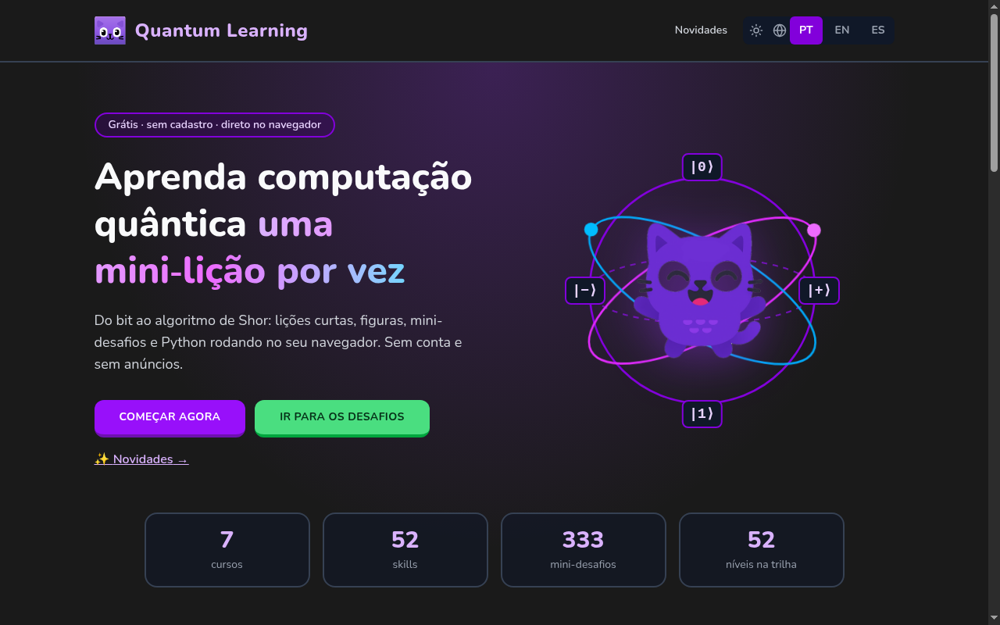

<p align="center">
  <a href="https://gubiogl.github.io/q-learning/"></a>
</p>

# Quantum Learning

Learn quantum computing from scratch, **one mini-lesson at a time**, for free and with no sign-up: **[gubiogl.github.io/q-learning](https://gubiogl.github.io/q-learning/)**

- **7 courses, 52 skills, 333 mini-challenges**: from bits and linear algebra to Grover, Shor, hardware and NISQ.
- **Mini-lessons**: each skill is a sequence of short steps; each step ends with a mini-challenge (a number, a text answer or Python that runs in the browser).
- **Challenges**: a single trail of quick levels with hearts and XP.
- Portuguese, English and Spanish; light and dark theme. Progress is saved in your browser (export/import included).

<p align="center"></p>

**What's new:** see the [updates page](https://gubiogl.github.io/q-learning/en/novidades/). Feedback, partnerships or using it in class? [Talk to me on LinkedIn](https://www.linkedin.com/in/gubio-gomes-de-lima-a99973106).

There is also a companion book, in LaTeX, in [`livro/`](livro/).

## Run it locally

```bash
npm install
npm run dev      # http://localhost:3000/q-learning/pt
npm test
```

Built with Next.js, TypeScript, Tailwind CSS, KaTeX and Pyodide.

## Contribute

See [`CONTRIBUTING.md`](CONTRIBUTING.md), the guide to [writing lessons](content/README.md) and the [roadmap](docs/ROADMAP.md).

Code under the [MIT License](LICENSE); lessons, illustrations and the book under [CC BY-SA 4.0](LICENSE-CONTENT.md).

## References & Credits

This project stands on the work of others. Lesson text and exercises are original, written with these sources as reference:

**Main content reference**
- Thomas G. Wong, *Introduction to Classical and Quantum Computing* (Rooted Grove, 2022) — [thomaswong.net](https://www.thomaswong.net). Lessons follow its chapters 1–4 and 6; no text is reproduced.

**Content and exercises**
- [PennyLane Codebook — Foundations of Quantum Computing](https://pennylane.ai/codebook/learning-paths/foundations-of-quantum-computing) (Xanadu)
- [Quantum-Codebooks — Xanadu Codebook notebooks](https://github.com/MonitSharma/Quantum-Codebooks/tree/main/Xanadu%20Quantum%20Codebook/Introduction) (Monit Sharma)
- Norton G. de Almeida, *Introdução à Computação e Informação Quântica* — [link](https://a.co/d/97aiWpu)
- [GIQSul Codebook](https://aprenda.quantumket.org)

**Platform and design inspiration**
- [Code With Antonio — Duolingo clone workshop](https://www.codewithantonio.com/workshops/duolingo-clone) and [repository](https://github.com/code-with-antonio/nextjs-duolingo-clone)
- [Coddy.tech](https://coddy.tech/pt) and its [Python course docs](https://coddy.tech/docs/pt/python)
- [Duolingo](https://www.duolingo.com)

**Authorship**
- Created and maintained by **Gubio Gomes de Lima**, who wrote the first version by hand and ran and reviewed every later change.
- [Claude](https://claude.com/claude-code) (Anthropic) helped with development as a contributor.
